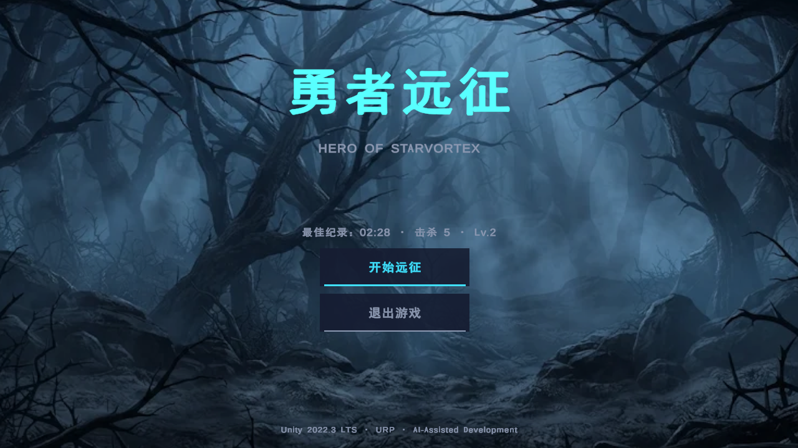
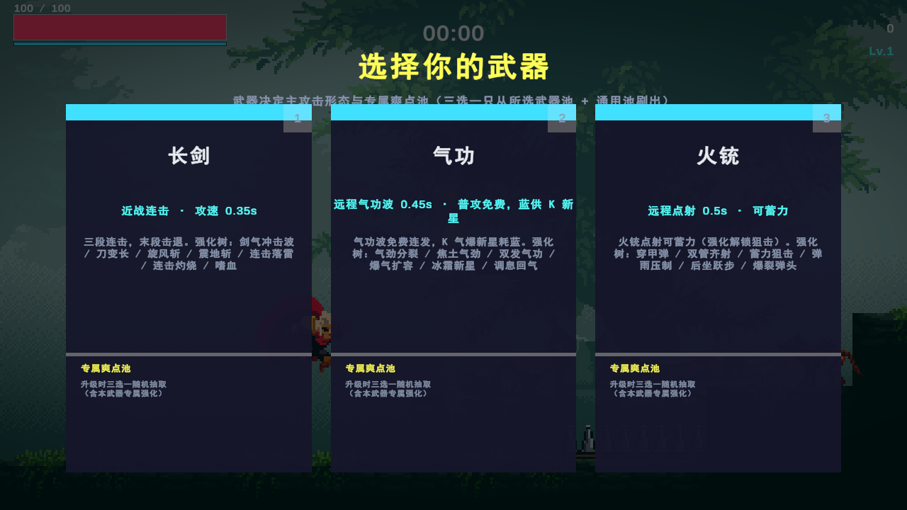
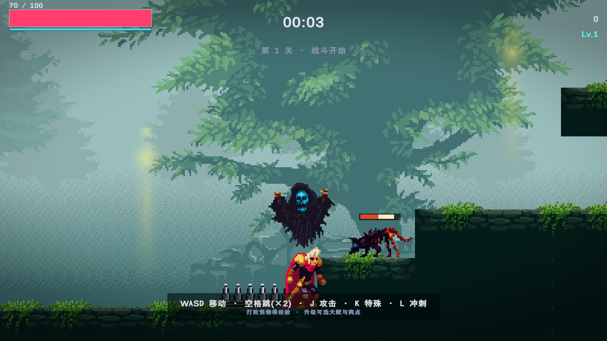
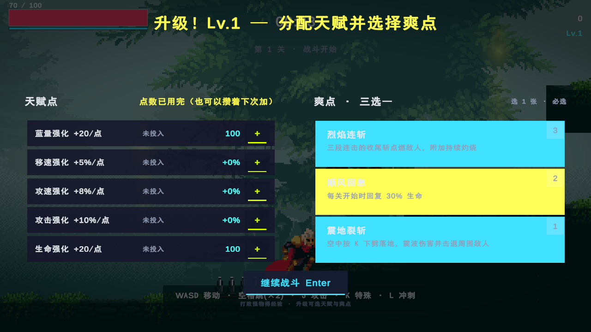
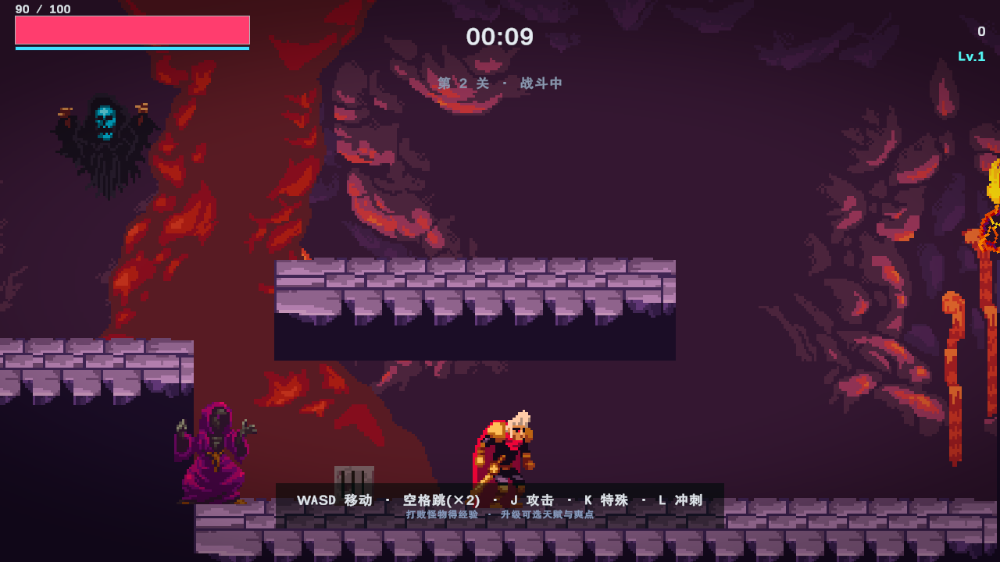
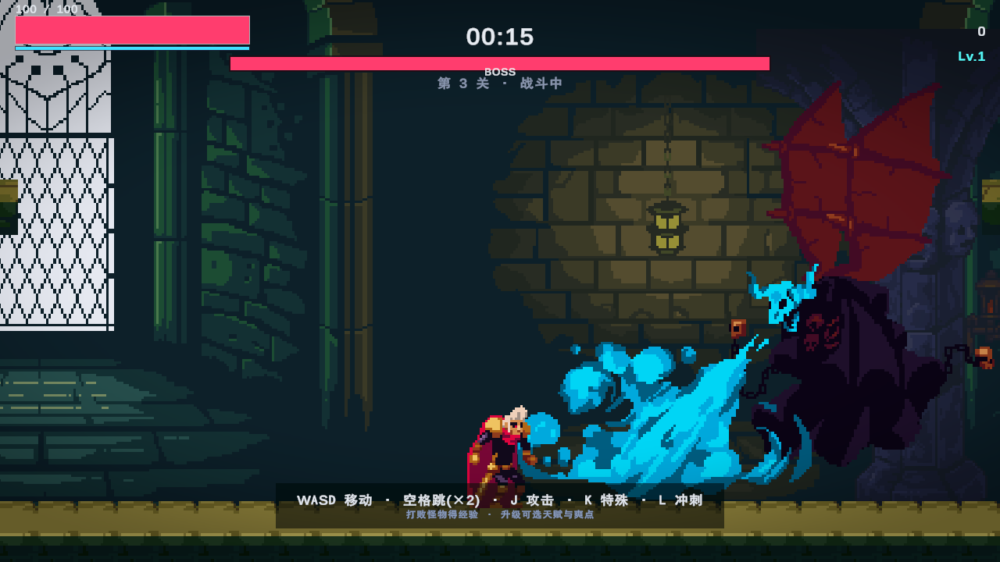
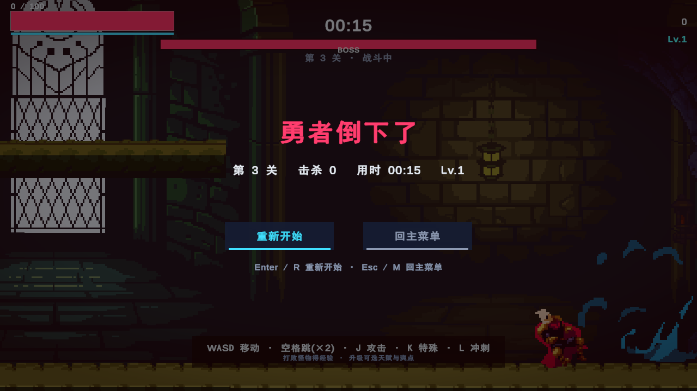

# 勇者远征 Hero of StarVortex

> Unity 2D 横版动作闯关 Demo：三选一职业，闯过雾林、熔岩洞窟、古堡内殿三关，击败三阶段 BOSS。
> 个人开发，AI 辅助编码 + 人工审查验证。美术用 CC0 像素素材，动画、场景、预制体、音效、字体由 Editor 脚本一键生成。



| 选择职业 | 第 1 关 · 灰烬森林 |
| --- | --- |
|  |  |
| **升级：天赋 + 强化三选一** | **第 2 关 · 坍塌矿洞** |
|  |  |
| **第 3 关 · 深渊王座（BOSS 战）** | **死亡结算** |
|  |  |

## 玩法

- **三个职业**：长剑（三段连击，近身突进）/ 气功（远程气功波，K 键耗蓝放气爆新星）/ 火铳（点射，强化后可蓄力狙击）。职业之间只换动画和攻击方式，共用一套角色控制器。
- **平台手感**：二段跳、冲刺（冲刺瞬间无敌）、土狼时间、跳跃缓冲、可变跳跃高度、跳跃顶点悬停。
- **五种怪物**，每种都有看得见的出招前摇：
  地狱犬（蹲伏蓄力后扑咬）、幽灵（尖啸后俯冲）、骷髅巫师（保持距离施放火球）、
  梦魇马（精英，霸体，震地波 + 冲锋，撞墙会眩晕）、恶魔（BOSS，三阶段，按血量解锁地刺阵、召唤、环形弹幕）。
- **关卡机关**：地刺、落石（感应触发）、周期喷火口（喷发前栅缝先亮起火光预警）。
- **成长**：击杀得经验，升级后分配天赋点（生命 / 攻击 / 攻速 / 移速 / 蓝量），再从"本职业强化池 + 通用池"中三选一。
- **完整流程**：主菜单 → 选职业 → 三关 → 通关结算；死亡结算可重新开始；Esc 暂停；最佳纪录本地存档。

**操作**：A / D 或 ← → 移动 · 空格 跳跃（空中再按一次二段跳）· J 攻击 · K 特殊技 · L 冲刺 · Esc 暂停 · 选职业时可按 1 / 2 / 3

## 技术要点

**Animator 状态机 + Override Controller（`EditorTools/HeroAnimationBuilder.cs`、`EnemyAnimationBuilder.cs`）**
三个职业共用一张状态机（Idle / Run / Jump / Fall / Attack / AirAttack / Hurt / Death），每个职业一个 `AnimatorOverrideController`，只换剪辑。五种怪物同理，共用一张 Idle / Move / Windup / Attack 状态机。攻击、受击走 Any State + Trigger，按添加顺序定优先级；一次性动作显式打开 Exit Time 回到移动层。代码只写参数，sprite 只由 Animator 写，不会出现两处同时改 sprite 的情况。

**横版平台物理（`Gameplay/HeroController.cs`）**
`Rigidbody2D` + 胶囊碰撞体。土狼时间 0.1s、跳跃缓冲 0.12s、下落重力 ×2.5、松键提前下落（×1.6）、顶点重力 ×0.6；勇者用零摩擦物理材质，避免推墙时被静摩擦"粘"在半空。地面探测忽略 Trigger，教学牌、传送门的触发盒不会被误判成地面（否则空中可以无限跳）。

**怪物：模板方法 + 显式状态机（`Gameplay/Enemies/`）**
`EnemyBase` 固定受击流程（伤害去重 → 血条 → 闪光 → 硬直 / 霸体 → 击退 → 死亡结算），子类只实现 `Behaviour()` 和 `ApplyKnockback()`。每个 AI 都是枚举状态机，动画参数只在状态切换处写一行，换素材不用改 AI。

**打击感（`Gameplay/Juice.cs`、`SpriteFlash.cs`、`EnemyHealthBar.cs`）**
命中停帧（真实时间恢复）、受击纯色剪影闪光、视觉层抖动、小怪硬直、精英 / BOSS 霸体、头顶血条（掉血残影延迟追上）、伤害数字、震屏（trauma² + Perlin）、死亡爆散序列帧。

**状态机收口 timeScale（`Core/GameManager.cs`）**
MainMenu / WeaponSelect / Playing / LevelUp / Paused / LevelClear / GameOver。所有 `Time.timeScale` 的写入都在 GameManager 里，选职业、升级、暂停、死亡这几个时间冻结来源不会互相抢。UI 动画全部走 unscaled time。

**事件总线 + 对象池（`Core/GameEvents.cs`、`Core/PoolService.cs`）**
玩法层发布事件，UI 只订阅，玩法代码不引用 UI。场景切换时 `ClearAllSubscribers()` 兜底清订阅。对象池基于官方 `UnityEngine.Pool.ObjectPool`，带预热和实例 → 预制体反查表，`Despawn` 一行调用。

**像素美术管线（`EditorTools/PixelArtPipeline.cs`、`PixelEnvironment.cs`）**
全项目统一 PPU 32、Point 过滤、不压缩，角色 pivot 在脚底中心；背景层高 = 相机视口高，人物、怪物、背景的像素大小一致。多层视差背景按关卡宽度和视差系数自动算铺满范围；地面用九宫格平铺，同高相邻地面段先合并，避免一段一道竖缝。

**一键搭建（`EditorTools/DemoSceneBuilder.cs`）**
菜单 `StarVortex/① 一键搭建 Demo`：导入像素帧 → 生成动画剪辑与状态机 → 音效合成 → 中文字体烘焙（自动扫描脚本里的中文文案补字）→ 预制体与职业数据 → 三关 + 主菜单场景 → UI 接线。关卡由 `LevelSpec` 数据描述（地形、平台、怪物、机关、目标），同一份数据既用于编辑器里铺地形，也用于运行时布置怪物。

## 验证状态

| 项目 | 结果 |
| --- | --- |
| 脚本编译 | 0 error |
| Windows EXE 构建 | 成功（Unity 2022.3.62f3c1，Mono，约 92MB） |
| 编辑器内自动试玩 | 三职业动作逐帧检查、五种怪物出招与死亡、三关切换、BOSS、死亡结算 / 重开 / 暂停 / 回主菜单流程（上面的截图即自动试玩时截取） |
| 单元测试 | 暂无（`Assets/Tests` 只有空的测试程序集） |

## 快速开始

1. 用 **Unity 2022.3 LTS**（开发版本 2022.3.62f3c1）打开项目根目录。
2. 执行菜单 `StarVortex / ① 一键搭建 Demo`（约 20 秒）。首次打开项目时也会弹窗询问是否搭建。
3. 打开 `Assets/Scenes/MainMenu.unity`，按 Play。
4. 打包：菜单 `StarVortex / ② 打包 Windows EXE`，输出到 `Builds/Windows/`。

## 目录结构

```
Assets/
  Scripts/
    Core/          GameManager 状态机、GameEvents 事件总线、PoolService 对象池、伤害接口、存档、补间
    Gameplay/      HeroController、Juice 打击感、弹丸、受击闪光、血条、序列帧特效
      Enemies/     EnemyBase + 地狱犬 / 幽灵 / 骷髅巫师 / 梦魇马 / 恶魔
      World/       LevelDirector 关卡流程、SideCamera、视差、机关、坠落回收、教学牌
    UI/            HUD、选职业、升级、关卡结算、死亡结算、暂停、主菜单
    EditorTools/   一键搭建、关卡构建、像素美术管线、动画状态机构建、音效合成
  Art/Pixel/       像素帧（角色 / 怪物 / 特效 / 环境），出处见 CREDITS.md
docs/              面试讲解稿、模拟面试问答、AI 辅助开发流程、截图
```

## 技术栈

| 类别 | 选型 |
| --- | --- |
| 引擎 | Unity 2022.3.62 LTS，C# 9（约 1.3 万行，68 个脚本，含编辑器工具） |
| 渲染 | URP 2D Renderer，2D 全局光，Bloom |
| 输入 | 新版 Input System |
| UI | UGUI + TextMeshPro（静态中文 SDF 字体，字表自动收集） |
| 动画 | Animator 状态机 + AnimatorOverrideController，序列帧剪辑由脚本生成 |
| 物理 | Rigidbody2D / Collider2D，实体碰撞与 Trigger 分开，层碰撞矩阵 |
| 工具链 | AI 辅助编码 + 人工审查 + 编辑器内自动试玩验证，Git 按功能提交 |

## 素材与许可

角色、怪物、环境与特效像素素材来自 ansimuz 的 Gothicvania 系列（OpenGameArt，CC0），详见 [CREDITS.md](CREDITS.md)。地刺为自绘。中文字体在搭建时从本机系统字体复制，不入库。
