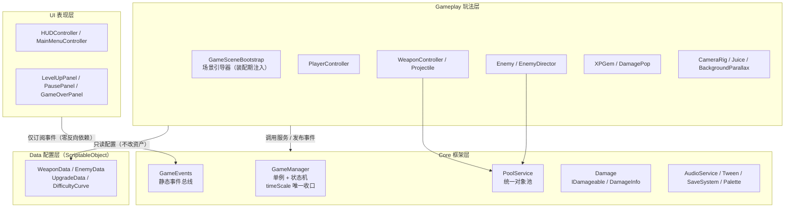

# 星涡幸存者 StarVortex

> 一款 Unity 2D 霓虹矢量风"幸存者割草"小游戏：在蜂拥而至的怪物潮中活过 10 分钟，边割边升级，构筑自己的成长路线。
> 由个人开发者 AI 辅助开发独立完成——零外部素材、零外部插件，全部资源由 Editor 脚本程序化生成。

## 游戏截图

<!-- 截图占位：运行 Unity 后按 Play 截图补充，建议 3 张（主菜单 / 战斗中 HUD / 升级三选一） -->

| 主菜单 | 战斗画面 | 升级三选一 |
| --- | --- | --- |
| （运行后补充） | （运行后补充） | （运行后补充） |

## 玩法特性

- **WASD / 手柄双通道移动**：新版 Input System 轮询，键盘与左摇杆输入归一化融合，防斜向加速。
- **全自动武器**：武器自动索敌最近敌人射击，多弹幕扇形展开，支持穿透与暴击（2 倍伤害）。
- **3 种敌人 + 精英变体**：浮游 drone / 冲锋 darter / 坦克 brute，精英血量 x4、体型 x1.4、经验 x6。
- **难度曲线成波刷怪**：刷怪速率、怪物组成权重、血量成长、精英概率全部由 AnimationCurve 驱动，一个资产管整局节奏。
- **经验宝石磁吸拾取**：进入拾取圈自动吸附、越吸越快，玩家会主动"扫图"。
- **升级三选一**：伤害 / 攻速 / 移速 / 最大HP / 拾取半径 / 弹幕数 / 暴击 / 回血共 8 种强化，不放回抽取 3 张。
- **完整局外循环**：主菜单 → 游戏 → 结算（存活时间 / 击杀数 / 等级），Json 最高分存档，支持暂停。

## 验证状态

| 验证项 | 结果 |
| --- | --- |
| 脚本编译 | 0 error / 0 warning |
| PlayMode 冒烟测试 | **7 / 7 通过**（资产完整性 / 场景引导 / 升级曲线 / 对象池复用 / 击杀掉落 / 刷怪上限压测 / 自动索敌开火） |
| Windows EXE 构建 | 成功（Unity 2022.3.62f3c1，Mono） |
| 真机运行 | 主菜单 / 中文 UI / 音频正常，无异常日志 |

> 测试运行方式：Unity 编辑器菜单 `Window → General → Test Runner → PlayMode`，
> 或命令行 `Unity.exe -batchmode -projectPath <path> -runTests -testPlatform PlayMode`。

## 技术亮点

**统一对象池（`Core/PoolService.cs`）**
基于 Unity 官方内置 `UnityEngine.Pool.ObjectPool` 做统一注册表，子弹、敌人、宝石、飘字全走池。预热水位把 Instantiate 成本挪到加载期；"实例 → 预制体反查表"让 Despawn 一行调用；collectionCheck 仅 Editor 开启。

**静态事件总线解耦（`Core/GameEvents.cs`）**
系统间通信用 C# event 静态总线，玩法层发布事件、UI 层只订阅——玩法层对 UI 层零依赖。场景卸载时 `ClearAllSubscribers()` 清空全部订阅，杜绝跨场景残留引用这一经典生命周期陷阱。

**timeScale 唯一收口（`Core/GameManager.cs`）**
单例 + 状态机（MainMenu / Playing / LevelUp / Paused / GameOver），升级暂停、手动暂停、死亡结算三个"时间冻结来源"互斥，所有 timeScale 修改收口在状态机，避免多系统互相抢 timeScale 的经典 bug。

**面向接口的伤害管线（`Core/Damage.cs`）**
`IDamageable` 接口 + `DamageInfo` struct（`in` 参数零 GC），弹丸只认接口不认具体类——新增可受击对象不需要改弹丸代码。

**ScriptableObject 数据驱动（`Data/*.cs`）**
WeaponData / EnemyData / UpgradeData / DifficultyCurve 四类资产；三种敌人共用一个 `Enemy` 类靠数据区分（组合优于继承）；平衡性调整只拖曲线滑条，不改代码不重新编译。

**性能节流**
分离力算法限流采样（最多 6 邻居、0.15s 节流），避开全量 O(n²) 两两分离；自动索敌 `OverlapCircleAll` 0.1s 节流；同屏敌人上限是帧率保护阀——宁可不刷，不能卡顿。

**打击感三件套（`Gameplay/Juice.cs`、`Gameplay/CameraRig.cs`）**
HitStop 停帧（timeScale 压 0.05、真实时间恢复、与弹窗状态互斥）+ 受击闪白（MaterialPropertyBlock 不实例化材质）+ 死亡粒子迸发（单 ParticleSystem.Emit 复用零实例化）；震屏用 trauma² 衰减 + Perlin 噪声驱动位移与旋转，多次受击叠加有上限不晃吐。

**UGUI 全套（`UI/*.cs`）**
HUD 血条残影缓动（主条秒跟、残影慢追）、底部经验条、三选一卡片、暂停、结算数字滚动；全部动画跑 unscaled time，timeScale=0 时 UI 照常播放。

**程序化资源管线（`EditorTools/`）**
霓虹矢量美术由 SDF 光栅器 + smoothstep 羽化抗锯齿逐像素生成（30 张 PNG）；音效手写 RIFF/WAVE 字节流合成（激光/爆炸/拾取/琶音/环境音乐）；TMP SDF 中文字体从系统字体生成并按需烘焙字符集。零外部素材、零版权风险。

**一键搭建（`EditorTools/DemoSceneBuilder.cs`）**
Editor 脚本一键生成：URP 资产 → 美术 → 音效 → 字体 → 数据资产 → 预制体 → 层碰撞矩阵 → 动画控制器 → 两个场景 → 全套 UGUI → 图集。项目从空仓库到可玩只需一次菜单命令，Git 仓库干净可复现。

## 架构图



依赖方向单向向下：Data 无依赖；Core 不含玩法逻辑；Gameplay 只调用 Core、只读 Data；UI 只订阅事件并在交互时调用 GameManager 的公开方法。

## 快速开始

1. 使用 **Unity 2022.3 LTS**（开发版本 2022.3.62，中国版）打开项目根目录。
2. 首次打开会弹出确认框"检测到项目尚未初始化"，点击**开始搭建**（约 1-2 分钟，生成美术/音效/字体/预制体/场景）；也可以稍后手动执行菜单 `StarVortex / ① 一键搭建 Demo`。
3. 打开 `Assets/Scenes/MainMenu` 场景，按 **Play** 开始游戏。
4. 操作：WASD / 方向键 / 手柄左摇杆移动，Esc 或 P 暂停，升级弹窗中按 1/2/3 快速选卡。

## 目录结构

```
docs/                     本文档、面试讲解稿、AI 辅助开发工作流
scripts/                  游戏脚本源码（与 Assets 同步）
  Core/                   框架层：GameManager / GameEvents / PoolService / Damage / Tween / AudioService / SaveSystem / Palette
  Gameplay/               玩法层：Player / Weapon / Projectile / Enemy / EnemyDirector / XPGem / CameraRig / Juice / Bootstrap
  UI/                     表现层：HUD / LevelUp / Pause / GameOver / MainMenu
  Data/                   ScriptableObject 配置类：WeaponData / EnemyData / UpgradeData / DifficultyCurve
  EditorTools/            编辑器工具：DemoSceneBuilder 一键搭建 / NeonArtGenerator 程序化美术 / SfxSynth 程序化音效
```

## 技术栈

| 类别 | 选型 |
| --- | --- |
| 引擎 | Unity 2022.3.62 LTS（中国版），C# 9 |
| 渲染 | URP，2D Renderer + 2D 光照 + Bloom 后处理（HDR 颜色喂发光） |
| 输入 | 新版 Input System（键盘 + 手柄） |
| UI | UGUI + TextMeshPro（SDF 中文字体，运行时烘焙字符集） |
| 物理 | Rigidbody2D / Collider2D，Trigger 与实体碰撞分层，Layer Collision Matrix 管理 |
| 数据 | ScriptableObject 资产驱动 + AnimationCurve 难度曲线 + JsonUtility 存档 |
| 性能 | UnityEngine.Pool 对象池 / 物理查询与算法节流 / MaterialPropertyBlock / 单次 Emit 粒子复用 |
| 工具链 | AI（ZCode/GLM）辅助编码 + 人工审查 + 批量编译验证，Git 分功能提交 |
